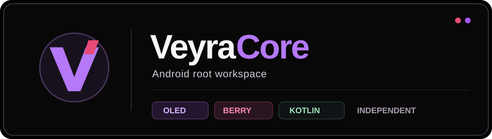

# VeyraCore 0.4.0-dev — Veyra Load & Helper

Neuer Quellstand der eigenständigen Android-App ctrl.veyracore. 0.4 erweitert den 0.3-Root-Katalog um eine echte, autorisierte SU-Kontrollschicht und eine eigene sichere Helper-Update-Strecke. Das ist keine Behauptung, alle 57 GhostLock-/DirtyFrag-Projekte als Exploit in der APK ausführen zu können.

- Veyra Load prüft UID0 und erkennt SU-/KernelSU-/Magisk-Runtimes, SELinux und Modulbestand.
- Module lassen sich nach erteilter Root-Berechtigung über einen nachgewiesenen ksud- oder magisk-Installer mit ZIP-Prüfung installieren.
- Helper: installierte UID, APK-Version und SHA-256 der Signatur werden unabhängig geprüft. Ein bestehender System-UID1000-Helper kann durch eine signaturgleiche APK über den Android-Installer aktualisiert werden.
- Permanente Benachrichtigung: nur bei UID1000-Nachweis, Berechtigung und passenden Android-Foreground-Service-Bedingungen.
- 57 Forschungsquellen, manuelle und automatische Profil-Vorauswahl, OLED/Berry-Design, Logs und Module/Superuser-Navigation bleiben erhalten.

[Implementierungsbericht 0.4](IMPLEMENTATION_REPORT_V040.md) · [Architektur](docs/ARCHITECTURE.md) · [Portquellen](docs/PORT_REGISTRY.md)

---

# VeyraCore — 0.3.0-dev Root-Katalog und Helper-Status

**Entwicklungsstand, keine vollständige native GhostLock/DirtyFrag-Suite.** Dieses Projekt ist eine eigenständige Android-App mit dem Paket ctrl.veyracore, kein KernelSU-Fork. Die bisherige Anwendung ctrl.mietze.veyracore bleibt unverändert.

**Neu in 0.3.0-dev:**
- 57 GitHub-Projekte als gruppierter, durchsuchbarer Quellenkatalog (Quelle ist nicht gleich geprüfter Exploit).
- Zwei veröffentlichte Metadaten-Supportfeeds mit Modell-/Kernel-Abgleich, begrenztem Download, lokalem Cache und klarer Trefferkennzeichnung.
- Wahl zwischen automatischer Methodenauswahl und manuellem Recherchemodus einschließlich aktivierbarer Geräteprüfung.
- Reale Root-Prüfung mit su -c id und UID0, auch nach Rückkehr von bestehenden Veyra Root, alter VeyraCore, ZF6Root, RMG und RMG Next.
- Android PackageManager-Prüfung der vorhandenen Veyra-Helper-App: UID1000 ist getrennt von UID0, kein vorgetäuschtes Zertifikat.
- Opt-in persistente Helper-Benachrichtigung über Foreground Service nach UID1000-Prüfung.
- Veyra OLED und Veyra Berry, weiterhin Module/Superuser bei nachgewiesenem Root, Logs und Export.

**Noch nicht integriert oder getestet:** 57 eigenständige native Exploit-Ports, universelles GhostLock/DirtyFrag-Reroot, Veyra-eigene Kernel-Treiber, selbständige Paketmanager-Zertifikatsinjektion. Das Root-Setup bleibt bei installierten kompatiblen Providern; jede Portierung benötigt eigene technische Prüfung.

Weitere Details: [Root-Quellen](docs/PORT_REGISTRY.md), [Architektur](docs/ARCHITECTURE.md), [Standbericht](IMPLEMENTATION_REPORT_NEXT.md).

---



# VeyraCore
### Independent Android root workspace • OLED & Berry • Kotlin / Compose

**VeyraCore** is an independent Android application for inspecting root state, exploring device-specific temporary-root compatibility, and managing installed root modules when **genuine UID 0** access is already present. It is not a renamed KernelSU manager, kernel patcher, or a universal exploit launcher.

**Package** `ctrl.veyracore` · **Current preview** `0.2.1-dev` · **Android** 13+ (API 33) · **Project** VeyraCore by ctrl-mietze.

## Two Veyra identities

| Veyra OLED | Veyra Berry |
|---|---|
| Pure #000000 black, violet #A855F7 | Dark berry #100C14, raspberry-rose #E84A77 |
| #080808 low-luminance cards | #1B1520 cards and #B17DF6 secondary accents |
| High legibility on AMOLED | Restrained blend of Raspberry Manager and Veyra Root |

Both themes are selectable within the application and saved across launches. The adaptive launcher icon is VeyraCore's own artwork.

## Inside the Android application

- **Home:** verified root state, device and firmware information, six individual setup checkpoints, and independent root-method cards.
- **Root method catalog:** Existing Root / SU, GhostLock, DirtyFrag, and Veyra Reroot / Helper. Source links and status indicate what is known and what is not installed or proven. An expandable research index presents 18 independent upstream references, without importing their native exploits.
- **Installed root tools:** explicit launch hand-off for a local Veyra Root, ZF6Root or Root My Galaxy Next installation, followed by a new UID-0 verification on return. The app never runs the external tool's exploit itself.
- **Modules:** appear after a real UID-0 proof. Inspect existing modules, toggle enable/disable, mark removal for next boot and import a ZIP selected with the Android document picker. The archive is scanned for path traversal, invalid entries and oversized extraction before being handed to a compatible, verified existing module installer after an explicit confirmation.
- **Superuser:** displays real evidence; **no fabricated permissions, allowlists or privileged daemon**.
- **Settings:** change color palette and copy diagnostic information.
- **Logs:** local structured records and user-accessible download export using MediaStore.

Module compatibility is limited to the capabilities exposed by the installed privileged runtime. An Android app that can launch a manager UI is not, by itself, a complete kernel, SU-policy, mount, or module-execution system.

## Security and scope

VeyraCore **does not bundle native GhostLock or DirtyFrag exploits**, remotely downloaded payloads, automatic exploit execution, modified boot images, an independent UID-0 daemon, or rewritten KernelSU kernel drivers. GhostLock/DirtyFrag availability requires an independently verified exact device, fingerprint, kernel and supported provider. A KMI match alone is insufficient. **System UID 1000 does not establish UID 0**. No automatic reboot or bootloader manipulation takes place.

Root operations are authorized by a live UID-0 check, bounded with timeouts and logged. Installed modules are third-party code: confirmation is required before installation. The ZIP staging process does not execute content. Only the existing verified module runtime may do so.

## Building from source

Prerequisites: JDK 17, Android SDK platform 36, standard Android build tools.

```powershell
$env:ANDROID_HOME = "$env:LOCALAPPDATA\Android\Sdk"
.\gradlew.bat testDebugUnitTest assembleDebug --no-daemon
```

Debug output: `app/build/outputs/apk/debug/app-debug.apk`. The debug APK is for testing, not signed as a public stable root release. Install alongside the existing `ctrl.mietze.veyracore` and `ctrl.mietze.veyraroot` without overwriting them.

## Architecture & further reading

- [Architecture](docs/ARCHITECTURE.md) — UI, privilege boundary, import validation and real root-state guarantees.
- [Method and source registry](docs/ROOT_PROVIDER_STATUS.md) — which sources are researched vs implemented.
- [Port registry](docs/PORT_REGISTRY.md) — no network service and no arbitrary shell listener.
- [Brand and interaction guide](docs/DESIGN_SYSTEM.md) — Veyra OLED / Veyra Berry palettes and screen principles.
- [Third-party credits](THIRD_PARTY.md) — external research and the obligation to retain licensed authorship when code is used.
- [Implementation report](IMPLEMENTATION_REPORT.md) — specifically what is delivered and what still needs on-device tests.
- [Development release notes](docs/RELEASE_NOTES_0.2.1.md) — verified changes in the new preview.
- [Contributing](CONTRIBUTING.md) — exact-build evidence and contribution standards.
- [Security policy](SECURITY.md) — private vulnerability reporting and root trust boundaries.

## Research references

| Source | Relevance |
|---|---|
| [Root My Galaxy Next](https://github.com/rushiranpise/Root-My-Galaxy-Next) | Root-chain reference, manufacturer support and helper research |
| [DirtyFrag](https://github.com/mitschud/DirtyFrag) | Device-specific Linux-kernel vulnerability research |
| [GhostSam](https://github.com/snothin/GhostSam) | Samsung temporary-root chains and device profiles |
| [Temporary root catalog](https://github.com/fynks/awesome-temporary-root) | Maintained cross-device discovery and exact build records |
| [KernelSU](https://github.com/tiann/KernelSU) | Public module format, commands and policy architecture |

These are references, not claims of native driver integration or compatibility.

---

VeyraCore is built for deliberate, verifiable control over devices you own and are authorized to modify. **No imaginary green checkmarks. No hidden flashing. No guesswork masquerading as support.**